<!-- =====================================================================
     PERFIL FRANCISCO LANCHE · ESTÉTICA TERMINAL LINUX (Tokyo Night)
     Los SVG con animaciones se generan con  tools/build_profile.py
     (timings estilo anime.js horneados como CSS + SMIL: GitHub no
     ejecuta JavaScript dentro de , pero sí animaciones SVG).
     ====================================================================== -->

<!-- =====================================================================
     ZONA 2 · cat habilidades.json
     ====================================================================== -->

<h2 align="center"><code>francisco@FranciscoLanche05</code>:~$ <code>cat habilidades.json</code></h2>

  <!-- Frontend -->
  
  
  
  
  
   
  <!-- Backend -->
  
  
  
  
  
   
  <!-- Datos & herramientas -->
  
  
  
  
  

<!-- =====================================================================
     ZONA 3 · ./stats.sh
     ====================================================================== -->

<h2 align="center"><code>francisco@FranciscoLanche05</code>:~$ <code>./stats.sh --verbose</code></h2>

  
  

  

<!-- =====================================================================
     ZONA 4 · python3 snake.py — la serpiente devoradora de commits
     ====================================================================== -->

<h2 align="center"><code>francisco@FranciscoLanche05</code>:~$ <code>python3 snake.py</code></h2>

  <picture>
    <source media="(prefers-color-scheme: dark)" srcset="https://raw.githubusercontent.com/FranciscoLanche05/FranciscoLanche05/output/github-contribution-grid-snake-dark.svg">
    <source media="(prefers-color-scheme: light)" srcset="https://raw.githubusercontent.com/FranciscoLanche05/FranciscoLanche05/output/github-contribution-grid-snake.svg">
    
  </picture>

<!-- =====================================================================
     ZONA 5 · cat contacto.txt
     ====================================================================== -->

<h2 align="center"><code>francisco@FranciscoLanche05</code>:~$ <code>cat contacto.txt</code></h2>

  

  
  
  
  
  

<!-- =====================================================================
     ZONA 6 · whoami / visitas
     ====================================================================== -->

  
  

  <b>francisco@FranciscoLanche05</b>:~$ <i>exit 0</i> — puerto cerrado, terminal viva.

